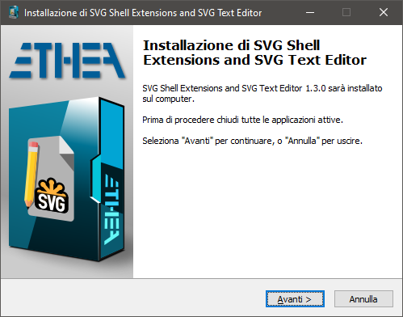
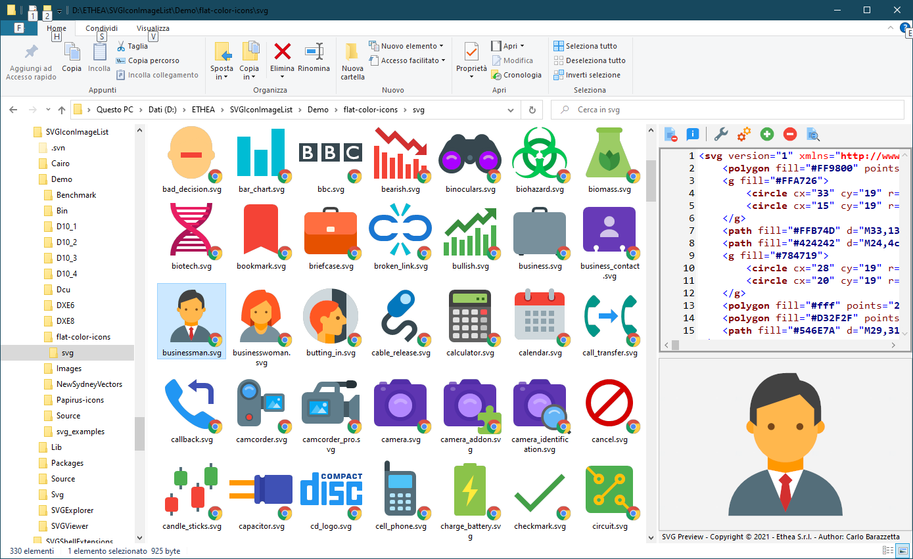
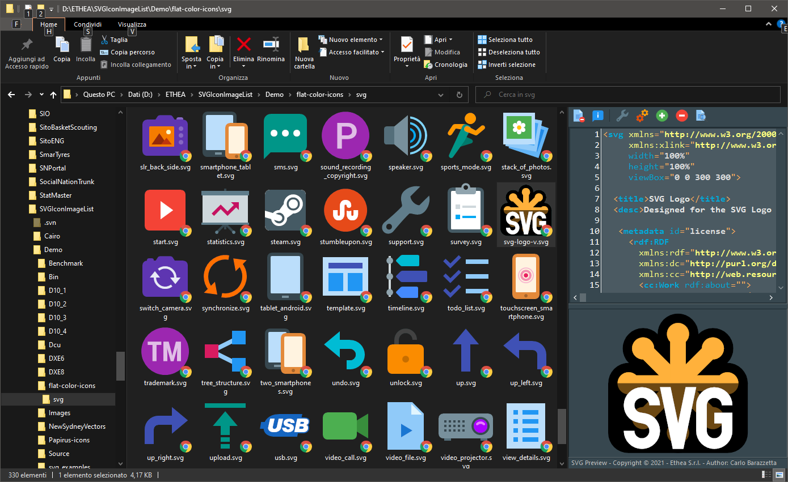
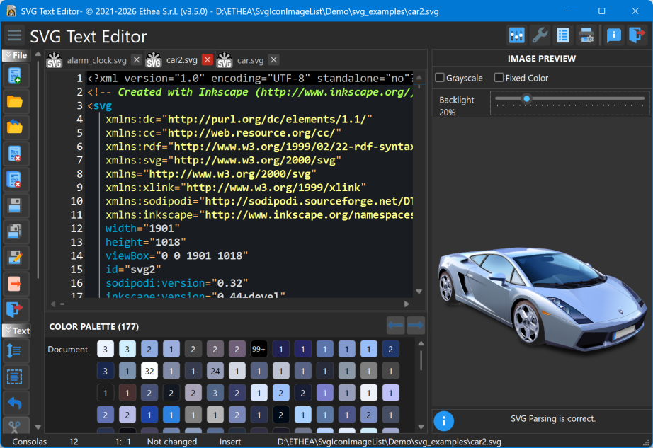
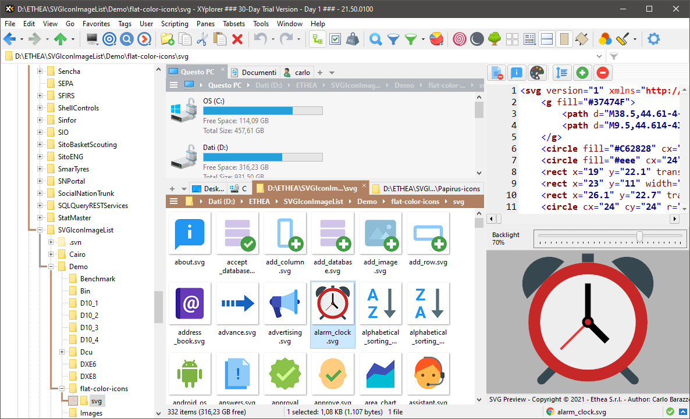

# SVG Editor and Shell Extensions

[](LICENSE)
[](https://github.com/EtheaDev/SVGShellExtensions/releases)
[](https://www.embarcadero.com/products/delphi)
[](https://docwiki.embarcadero.com/RADStudio/en/Main_Page)
[](https://www.microsoft.com/windows)

**A collection of extensions tools for SVG files, integrated into Microsoft Windows Explorer (for Windows 10 and 11) and a useful SVG Text Editor:**


Related links: [embarcadero.com][10] - [learndelphi.org][11]

---
 
- A [Preview handler][1]  which allows you to see the SVG image and text without open it, in the "Preview Panel".
 
- A [Thumbnail handler][2] which allows you to see the SVG image into Windows Explorer.

- An [SVG-XML Text Editor][12] to manually edit and preview the text of SVG files.

### Documentation

Follow the [Project Site](https://ethea.it/docs/svgtools/) to know all the SVG tools: SVG Text Editor, Shell Extensions (Preview Panel, Thumbnails and Context menu) and the SVGToPNG command-line tool.

### Features

- Supports Windows 10 and 11 (for 32 bits and 64 bits).

- Themes (Dark and Light) according to user preferences of Windows Theme

- Integrated also with other Shell Applications (like XYplorer)

### Setup using the Installer

Click to download the [SVGShellExtensionsSetup.exe][3] located also in the Release area. The Installer works both for 32 and 64 bit system.



***For a clean Setup close all the windows explorer instances which have the preview handler active or the preview handler was used (remember the dll remains in memory until the windows explorer was closed).***

### Preview Panel and Thumbnails in action ###

In Windows 11 with Light theme:



In Windows 11 with Dark theme:



### SVG Text Editor

A useful Text editor with preview of SVG Image:



**Color palette**: under the editor a panel shows all the colors used by the SVG, with the number of occurrences of each one. Colors are found in the presentation attributes (`fill`, `stroke`, `stop-color`, `flood-color`, `lighting-color`, `color`, `solid-color`), in `style` attributes and in `<style>` blocks, written as hex (`#rgb`, `#rgba`, `#rrggbb`, `#rrggbbaa`), `rgb()`, `rgba()`, `hsl()`, `hsla()` or color names; the same color written in different ways is shown once.

- Click on a color to highlight all its occurrences in the text, then move between them with `Alt+Right` / `Alt+Left` or with the arrow buttons of the palette.
- When the caret is on a color value, the corresponding color is marked in the palette.
- Double-click on a color to replace the color value under the caret (keeping its notation and opacity), or to insert it at the caret position as `#RRGGBB`.
- Right-click on a color to replace all its occurrences with another color (one single undo), to select all its occurrences with multiple carets, or to copy its value.
- Add your own colors to the "Custom" section with the `+` button (color picker) or from the context menu: they are kept for all files and shared with the custom colors of the color picker.
- The hint of each color shows its value, the properties using it and its opacities.
- The palette can be hidden in the Settings ("Show color palette under the editor").

### Automatic updates

The SVG Text Editor checks if a new version is available on GitHub, then downloads and installs it:

- **Automatic check**: at startup, once every *n* days (7 by default), in background; it can be disabled or its interval changed in Settings - Updates.
- **Manual check**: with the "Check for updates" button of the About dialog.
- When a new version is available the editor asks to download it: the About dialog shows the progress of the download (that can be stopped), then the editor starts the Setup and closes itself.

### COMMAND LINE TOOLS


**SVGToPNG** is a command-line utility for batch converting SVG files to PNG images.

It supports:

- Wildcard patterns for batch processing (e.g. `*.svg`)
- Multiple output sizes in a single run (e.g. `16,32,48,64,128,256`)
- Optional fixed color, grayscale and opacity settings

**Usage:**
```
SVGToPNG convert -in:<InputPattern> -size:<Sizes> <options>
Options:
 -color|-c:<color>            Fixed color to apply (e.g. clBlack, #FF0000) ((Optional))
 -grayscale|-g:<grayscale>    Convert to grayscale ((Optional))
 -in|-i:<in>                  SVG input file or wildcard pattern (e.g. *.svg) ((Required))
 -opacity|-a:<opacity>        Opacity value from 0.0 to 1.0 ((Optional))
 -out|-o:<out>                Output folder for generated PNG files ((Optional))
 -size|-s:<size>              PNG sizes separated by comma (e.g. 16,32,48,64) ((Required))
Examples:
  SVGToPNG convert -in:"C:\icons\*.svg" -size:32
  SVGToPNG convert -in:"C:\icons\home.svg" -size:16,32,48,64 -out:"C:\output"
  SVGToPNG convert -in:"*.svg" -size:256 -grayscale
```

### Support for XYplorer ###

As requested by many users of popular shell alternative, the new version supports XYplorer for Thumbnails and Preview Panel: follow the [configuration guide...](https://github.com/EtheaDev/SVGShellExtensions/wiki/XYplorer-Support)



### Manual Build and Installation (for Delphi developers) ###

If you have Delphi 12 or 13, you can manually build the project:

***Warning: To build the DLL you need also other open-source projects***

- [SVGIconImageList][4]

- [Synedit][5]

- [VCL-Style-Utils][6]

To build SVGToPNG Tool you can use `BuildSVGToPNG.cmd` in the `Tools/SVGToPNG/Project/` folder.

To manually install the SVGShellExtensions.dll follow these steps:

1. Close all the windows explorer instances which have the preview handler active or the preview handler was used (remember the dll remains in memory until the windows explorer was closed).
  
2. If you have already used the installer uninstall the components from system.
     
3. To install manually the dll run the `Setup\Register64bit.bat` (run-as-administrator).

4. If you wanto to uninstall the dll you use the `Setup\UnRegister64Bit.bat`

5. When it's registered, you can continue to change code and rebuild the dll (beware to close all Explorer instances).

## Release Notes ##
30 Oct 2026: ver. 3.5.2
- SVG Text Editor: "Word-Wrap Text" and "Show Line Numbers" in the context menu of the editor, with a check mark: they switch word wrap and line numbers in every open editor and are saved with the other editor options (as in the Editor options dialog)
- Setup: no language selection dialog, the installer uses the language of Windows
- License and credits: the same list of third party libraries in the setup, in the README and in the About dialog
- New logo, box and setup wizard image of the product
- Uses StyledComponents 4.5.0

20 Oct 2026: ver. 3.5.1
- SVG Text Editor: fixed the icons of the side menu and of the toolbar, missing when the editor was started without files (also in the Preview Panel).
- Removed the obsolete Windows10 styles; on Windows 10 the default style is now "Windows Modern" (light) or "Windows Modern SlateGray" (dark), and a stored style no longer available falls back to the default one.
- Settings, Theme page: every available style is offered, classified as light or dark automatically ("Windows Modern" and "Windows Modern SlateGray" were missing).
- About: copyright updated to 2026.
- Version aligned to 3.5.1 on every project and on the setup.

12 Oct 2026: ver. 3.5.0
- SVG Text Editor: new Color palette panel under the editor, showing the colors used in the SVG text (presentation attributes, style attributes and `<style>` blocks; hex, rgb(), rgba(), hsl(), hsla() and named colors), grouped by color with the number of occurrences and a hint with value, properties and opacities.
- SVG Text Editor: click on a palette color to highlight all its occurrences in the text; move between them with Alt+Right / Alt+Left or with the arrow buttons of the palette.
- SVG Text Editor: the palette marks the color under the editor caret.
- SVG Text Editor: double-click on a palette color to replace the color under the caret, keeping its notation (hex, rgb(), hsl(), name) and opacity, or to insert it at the caret.
- SVG Text Editor: palette context menu to replace all the occurrences of a color, select them with multiple carets, copy the color value, add or remove custom colors.
- SVG Text Editor: custom colors added with the color picker, kept for all files and shared with the custom colors of the color picker.
- SVG Text Editor: option in Settings to show or hide the color palette; its height is remembered.
- Added the Google Skia (Skia4Delphi) SVG rendering engine, beside Image32 and Direct2D: it can be selected in Settings ("SVG rendering options") and is used by the Preview, the Thumbnails and the SVG Text Editor.
- SVG Text Editor: the "Automatic check" option for new versions and its interval in days are respected again: the check ran at every startup, also when disabled.
- Fixed a typo in the message of the new version available.
- The web help link of the About dialog points to the new documentation site https://ethea.it/docs/svgtools/.
- Version aligned to 3.5.0 on every project and on the setup.

03 Sep 2026: ver. 3.4.2
- Fixed a GDI handle and memory leak in the Thumbnail provider: the bitmap handed over to Explorer was released incorrectly, so every generated thumbnail leaked resources inside the Explorer process.
- The shared resources data module is now a single instance created on demand, instead of one created and destroyed by every preview.
- Fixed the preview of ANSI-encoded SVG files, which produced an empty pane.
- SVG Text Editor: files whose extension is uppercase (.SVG) can now be opened. The check was a case-sensitive substring search, which also wrongly accepted names ending in ".xm" or ".s".
- SVG Text Editor: the SVG is no longer re-parsed at every keystroke.
- SVG Text Editor: fixed memory-management defects on the file-opening error path.
- SVG Text Editor: closing with unsaved changes can now be cancelled;
- SVG Text Editor: removed the Help button from the error dialog, which did nothing; the WM_COPYDATA payload is now bounded in size.
- The new-version check runs in background at startup instead of blocking the interface, tolerates release tags without the leading "v", and no longer crashes when the download starts right after the automatic check.
- Web help now points to https://ethea.it/componenti/svgshellextensions/, while the Issues button and the new-version check point to GitHub.
- Fixed the Debug configuration of the SVG Text Editor and SVGToPNG projects, which could not be built at all.
- Version aligned to 3.4.2 on every project, on the setup and on this document: SVG Text Editor still declared 3.4.0, and therefore offered an update to a version older than the installed one.
- Reduced the size of the thumbnail log and removed unused code.

03 Jun 2026: ver. 3.4.1
- Added single-instance behavior: opening a SVG file now reuses the running editor instead of starting a new one.
- Added Settings option to remember and reopen files from the last session.

27 Feb 2026: ver. 3.4.0
- Added command line Tool SVGToPNG

07 Sep 2025: ver. 3.3.1
- Built with Delphi 13
- Refactoring PageControl to speedup loading
- Added check for new version available, download and install
- Updated Setup
- Updated the latest Image32 library

01 Mar 2025: ver. 3.3.0
- Added "Wordwrap option" for the editor (active by default)
- Updated the latest Image32 library
- Added Color options in Viewer GUI (Grayscale, FixedColor, ApplyFixedColorToRootOnly)
- Added Color options in Editor GUI
- Updated to Image32 4.6 Released Feb 2025 to fix some drawing issue

14 Sep 2024: ver. 3.2.3
- Built with Delphi 12.2
- Update Image32 Engine to fix rendering of some SVG Icons

27 Aug 2024: ver. 3.2.2
- Use of TFormTabsBar component (Delphi 12) for paging
- Use of Styledmessage dialogs
- Updated Setup to show errors registering dlls

28 May 2024: ver. 3.2.1
- Aligned to latest Image32 Library
- Fixed Initialization of GDI+
- Added File Changed notification and reload
- Added use of StyledComponents and Rounded Buttons in Editor and Viewer

08 Jan 2024: ver. 3.2.0
- Aligned to latest Image32 Library
- Updated Copyright
- Added Clipboard copy SVG as PNG
- Built with Delphi 12

25 Oct 2023: ver. 3.1.0
- Added "close button" over Tabs
- Removed "TSVG" rendering option
- Updated to Image32 ver. 4.4 (30 Jan 2023)
- Updated to Skia4Delphi ver. 6.0.0 beta 5
- Added support for Delphi 12

24 Sep 2022: ver. 3.0.0
- Fixed Scrollbar colors viewing text in preview
- Fixed "empty panel" viewing text in preview
- Fixed "context-menu" for export to PNG (image lost)

18 Sep 2022: ver. 2.9.0
- Fixed Preview size in multi-monitor
- Fixed flickering of Preview

13 Sep 2022: ver. 2.8.0
- Fixed load file with blanks in content menu
- Built with Delphi 11.2

10 Apr 2022 - Version 2.7.0
- Updated Image32 Library
- Built with Delphi 11.1

16 Feb 2022 - Version 2.6.1
- Updated Image32 Library

20 Jan 2022 - Version 2.6
- Added support for Windows 11
- Updated Image32 Library
 - Fixed resize content

06 Nov 2021 - Version 2.5
- Fixed Export to png files

23 Oct 2021 - Version 2.4
- Added new Windows11 Styles (Dark and Light)

04 Sep 2021 - Version 2.3
- Added support for Delphi 11
- Built with Delphi 11
- Updated Image32 Library

03 Aug 2021 - Version 2.2
- Fixed PreferDirect2D default to false

31 Jul 2021 - Version 2.1
- Updated Image32 to 3.0 version
- Updated some sample images

25 Jul 2021 - Version 2.0
- Changed default SVG engine to Image32 for better results
- Updated Setup

05 Jul 2021
- Added drag-drop support for external files into editor
- Updated Setup with certificate

21 Jun 2021
- Updated some icons
- Update icon preview when SVGFactory changes

03 Apr 2021
- Fixed Close-All (Editor): clear preview
- Fixed save to png file extensions
- Removed memory-leak check closing app

05 Mar 2021
- Fixed SVG XML Editor preview after loading file
- Added support for storing/remember Editor options
- Some minor fixes

28 Feb 2021
- Fixed Context-Menu

27 Feb 2021
- Added 32 bit support
- Fixed some issue into SVG Text Editor

22 Feb 2021
- Added SVG Text Editor
- Added new Settings dialog
- Added Context-menu to open Editor and export to PNG
- Added Direct2D Engine for Preview Panel

09 Feb 2021
- Added Setup asset
- Fixed check for active Windows Theme
- Released v.1.0.0
- Released v.1.0.1

08 Feb 2021
- Added SVG Thumbnail Provider

31 Jan 2021
- Added SVG file Preview panel

## Credits

Many thanks to **Rodrigo Ruz V.** (author of [theroadtodelphi.com][7] Blog) for his wonderful work on [delphi-preview-handler][8] from which this project has used a lot of code and inspiration.

## License

Licensed under the [Apache License, Version 2.0][9] (the "License");
Unless required by applicable law or agreed to in writing, software distributed under the License is distributed on an "AS IS" BASIS, WITHOUT WARRANTIES OR CONDITIONS OF ANY KIND, either express or implied. See the License for the specific language governing permissions and limitations under the License.

<!-- credits:begin -->
Copyright © 2021-2026 Ethea S.r.l.

### Credits

Author: Carlo Barazzetta  
Custom icons: Ariel Montes  
Source project: https://github.com/EtheaDev/SVGShellExtensions  

### Other libraries from Ethea

- **[SVGIconImageList](https://github.com/EtheaDev/SVGIconImageList)**
- **[StyledComponents](https://github.com/EtheaDev/StyledComponents)**

### Third party libraries

- **[Delphi Preview Handler](https://github.com/RRUZ/delphi-preview-handler)**  
  The Initial Developer of the Original Code is Rodrigo Ruz V.  
  Portions created by Rodrigo Ruz V. are Copyright © 2011-2023 Rodrigo Ruz V.
- **[VCL Styles Utils](https://github.com/RRUZ/vcl-styles-utils)**  
  Portions created by Rodrigo Ruz V. are Copyright © 2012-2023 Rodrigo Ruz V. (Mozilla Public License 1.1)
- **[SynEdit (PyScripter fork)](https://github.com/pyscripter/SynEdit)**  
  Portions created by Martin Waldenburg are Copyright © 1998 Martin Waldenburg (Mozilla Public License 1.1)
- **[Image32 Library](https://www.angusj.com/delphi/image32/Docs/_Body.htm)**  
  Copyright © 2019-2025 Angus Johnson (Boost Software License)
<!-- credits:end -->

[1]: https://docs.microsoft.com/en-us/windows/win32/shell/preview-handlers

[2]: https://docs.microsoft.com/en-us/windows/win32/shell/thumbnail-providers

[3]: https://github.com/EtheaDev/SVGShellExtensions/releases/latest/download/SVGShellExtensionsSetup.exe

[4]: https://ethea.it/docs/svgiconimagelist/

[5]: https://github.com/pyscripter/SynEdit/

[6]: https://github.com/RRUZ/vcl-styles-utils/

[7]: https://theroadtodelphi.com/

[8]: https://github.com/RRUZ/delphi-preview-handler/

[9]: https://opensource.org/licenses/Apache-2.0/

[10]: https://www.embarcadero.com/

[11]: https://learndelphi.org/

[12]: https://github.com/EtheaDev/SVGShellExtensions/wiki/Using-The-SVG-Text-Editor

